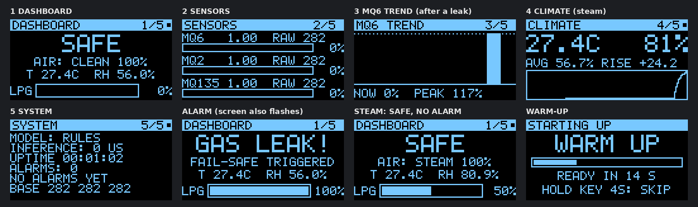
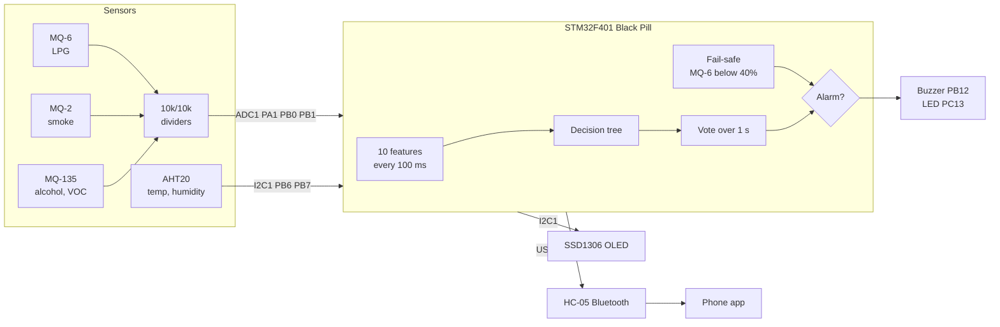
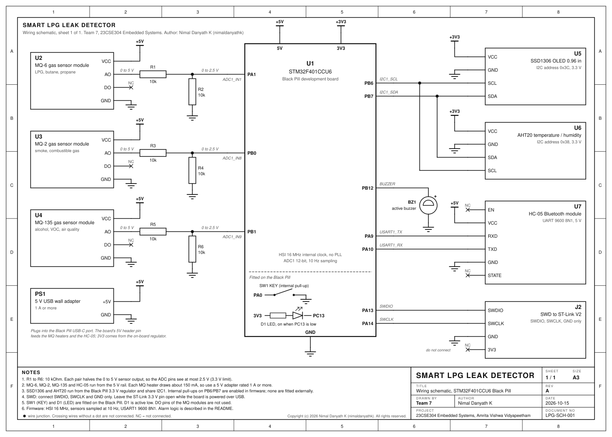
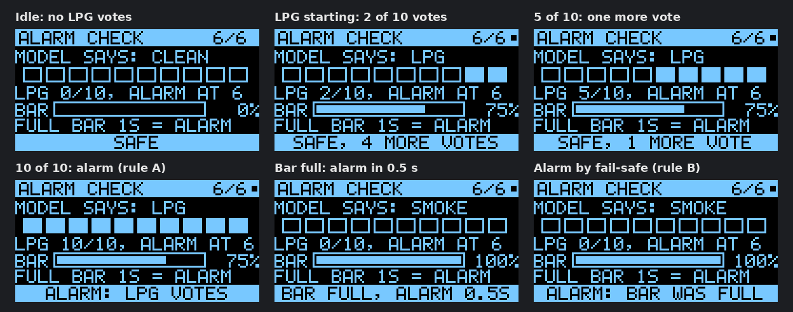
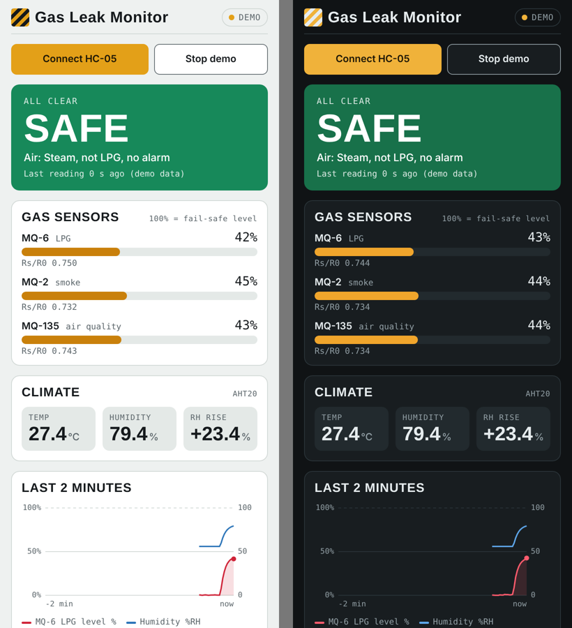

# Smart LPG Leak Detector on STM32

A kitchen gas leak detector built on an **STM32F401CCU6 (Black Pill)**. It uses three metal-oxide gas sensors and a humidity sensor, runs a small **machine-learning classifier on the chip**, and raises an alarm only for a real LPG leak. Cooking smoke, steam and alcohol vapour are recognised and ignored.

Case study for **23CSE304 Embedded Systems**, Amrita Vishwa Vidyapeetham.
Author: Nimal Danyath K ([@nimaldanyathk](https://github.com/nimaldanyathk))

Phone app: https://nimaldanyathk.github.io/stm32-lpg-leak-detector/phone_app/gas_monitor.html (open in Chrome on Android, or Chrome / Edge on a laptop)



---

## The problem

An ordinary gas alarm uses one sensor and one threshold. It cannot tell LPG from cooking smoke or steam, so it goes off while people cook. People then switch it off, and nobody is protected when a real leak happens.

This project reads **three gas sensors at once**. LPG, smoke, steam and alcohol each change the three sensors in a different pattern. A decision tree running on the STM32 reads that pattern and decides whether it is a real leak. A separate fail-safe rule makes sure a strong leak always raises the alarm, whatever the model says.

## Features

- MQ-6, MQ-2 and MQ-135 gas sensors read 10 times a second over the ADC
- AHT20 temperature and humidity sensor over I2C (humidity helps tell steam from gas)
- On-chip classifier: CLEAN AIR, LPG, SMOKE, STEAM, ALCOHOL/VOC
- Fail-safe: a strong MQ-6 response always alarms, even if the model disagrees
- 0.96" SSD1306 OLED with 6 pages: dashboard, sensors, 2-minute trend graph, climate, system, and a live ALARM CHECK page that shows the model voting
- Auto page mode for demos (pages change every 5 s)
- Buzzer and LED alarm, with a 60 s mute that is refused during a strong leak
- HC-05 Bluetooth: live status, commands, and data logging for training
- Phone and laptop app (`phone_app/gas_monitor.html`) with live gauges, chart and alarm
- Self test, wiring fault detection, alarm event log
- Training script that turns recorded data into C code for the chip
- Register-level C with CMSIS only, no HAL

---

## How it works



1. **Each MQ sensor is a tiny heated resistor.** When gas reaches it, its resistance drops. More gas means a bigger drop.
2. **Warm-up (2 minutes).** The heaters stabilise.
3. **Calibration (10 seconds, clean air).** The detector stores the clean-air value of each sensor. On screen this is **Rs/R0 = 1.00**.
4. **Every 100 ms** it reads all sensors and compares each one with its clean-air value:

   | Rs/R0 | Meaning |
   |---|---|
   | 1.00 | same as clean air |
   | 0.80 | resistance fell 20%, a little gas |
   | 0.40 | resistance fell 60%, a lot of gas |

5. **10 features** are computed: the three Rs/R0 values, the ratios between sensors, how fast MQ-6 and MQ-2 are changing over 3 s, and how fast humidity is rising.
6. **The classifier** labels the air. The last 10 decisions (1 second) are voted on, so one noisy reading cannot trigger the alarm.
7. **The alarm** sounds when either rule below is true, and stops after 5 s of safe readings.

### When the buzzer sounds

| Rule | Condition | Setting in `firmware/main.c` |
|---|---|---|
| **A. Strong gas (fail-safe)** | MQ-6 Rs/R0 below **0.40** for **1 s** | `FAILSAFE_R6`, `FAILSAFE_HOLD` |
| **B. LPG pattern (model)** | Model says LPG in **6 of the last 10** readings | `LPG_VOTES_TO_ALARM`, `VOTE_WINDOW` |
| Stops | **5 s** of safe readings | `CLEAR_SAMPLES` |

The threshold is relative to the clean-air calibration, not an absolute ppm value. Without a calibrated gas source the readings cannot honestly be converted to ppm.

Until the model is trained on your own recordings, `firmware/model.h` holds simple hand-set rules. LPG is recognised when MQ-6 drops at least 20% more than MQ-135.

| Buzzer sound | Meaning |
|---|---|
| Fast beep, beep, beep, continuous | Gas alarm |
| One short chirp every 2 s | A sensor wire is loose or a divider is missing |
| Single beep | Power on, calibration done, self test, button press |

---

## Hardware

| Part | Purpose |
|---|---|
| STM32F401CCU6 Black Pill | Microcontroller, Cortex-M4 with FPU |
| MQ-6 module | LPG, butane, propane |
| MQ-2 module | Smoke and combustible gases |
| MQ-135 module | Alcohol, VOC, air quality |
| AHT20 module | Temperature and humidity |
| 0.96" SSD1306 OLED, I2C | Display |
| HC-05 | Bluetooth serial link |
| Buzzer | Audible alarm |
| 6 x 10 kOhm resistors | Three voltage dividers for the MQ outputs |
| ST-Link V2 | Programming over SWD |
| 5 V USB charger, breadboard, jumper wires | Power and wiring |

## Pin connections

| Device pin | Black Pill pin | Notes |
|---|---|---|
| MQ-6 AO | **A1** (ADC1_IN1) | through 10k/10k divider |
| MQ-2 AO | **B0** (ADC1_IN8) | through 10k/10k divider |
| MQ-135 AO | **B1** (ADC1_IN9) | through 10k/10k divider |
| MQ-6 / MQ-2 / MQ-135 VCC, GND | 5V rail, G | heaters need 5 V, about 150 mA each |
| OLED SCL, SDA | **B6, B7** (I2C1) | address 0x3C |
| OLED VCC, GND | 3V3, G | |
| AHT20 SCL, SDA | **B6, B7** (shared with OLED) | address 0x38 |
| AHT20 VCC, GND | 3V3, G | |
| HC-05 TXD | **A10** (USART1 RX) | 9600 baud |
| HC-05 RXD | **A9** (USART1 TX) | |
| HC-05 VCC, GND | 5V, G | |
| Buzzer + | **B12** | buzzer - to G |
| Onboard LED | PC13 | active low |
| Onboard KEY button | PA0 | |
| ST-Link SWDIO, SWCLK, GND | DIO, CLK, G (end header) | **do not connect ST-Link 3.3V** |

### Voltage divider (one per MQ sensor)

```
MQ AO ----[10k]----+----[10k]---- GND
                   |
                   +---- STM32 pin (A1, B0 or B1)
```

The MQ output can reach 5 V and the STM32 pins are 3.3 V only. The divider halves the voltage. **Never connect an MQ output straight to the STM32.** The firmware reports `DIVIDER FAULT` if it sees a voltage that is only possible without the divider.

### Power

- Power the Black Pill from a **5 V USB wall charger**. Its 5V pin feeds the 5 V rail for the three MQ heaters and the HC-05. A laptop USB port (500 mA) is not enough for three heaters.
- Connect the ST-Link with **three wires only** (SWDIO, SWCLK, GND). Connecting its 3.3V pin while the board is also on USB puts two supplies against each other.

## Circuit diagram

[](docs/schematic/lpg_detector_schematic.svg)

Drawing LPG-SCH-001, rev A. Click the sheet to open it at full size; it is a vector SVG, so it stays sharp at any zoom. `docs/schematic/make_schematic.py` regenerates it.

| Ref | Part | Connection |
|---|---|---|
| U1 | STM32F401CCU6 Black Pill | all signals; 5 V in over USB-C |
| U2, U3, U4 | MQ-6, MQ-2, MQ-135 modules | AO through R1/R2, R3/R4, R5/R6 to PA1, PB0, PB1; 5 V |
| R1 to R6 | 10 kOhm | three 2:1 dividers, 0 to 5 V in, 0 to 2.5 V out |
| U5 | SSD1306 OLED, address 0x3C | I2C1 on PB6 (SCL), PB7 (SDA); 3V3 |
| U6 | AHT20, address 0x38 | same I2C1 bus; 3V3 |
| U7 | HC-05 Bluetooth | PA9 (TX) to RXD, PA10 (RX) to TXD; 5 V |
| BZ1 | Active buzzer | PB12 to buzzer +, buzzer - to GND |
| J2 | SWD to ST-Link V2 | PA13 SWDIO, PA14 SWCLK, GND; 3.3 V pin left open |
| SW1, D1 | KEY button, LED | fitted on the Black Pill, PA0 and PC13 |
| PS1 | 5 V USB wall adapter, 1 A or more | Black Pill USB-C port |

---

## Repository layout

```
firmware/
  main.c              full firmware (add this file to the Keil project)
  features.h          feature maths, shared exactly with ml/train.py
  model.h             classifier (placeholder rules until you train)
  single_file/main.c  the same firmware merged into one file
ml/
  train.py            trains the decision tree, writes firmware/model.h
  requirements.txt
  logs/               put recorded log files here
phone_app/
  gas_monitor.html    phone / laptop dashboard over Bluetooth
bringup_tests/
  hardware_tests.c    step-by-step hardware tests (LED, I2C, OLED, buzzer, ADC, Bluetooth)
  oled_test.c         OLED only
  blink_button.c      LED and button only, no external parts
docs/images/          screenshots
docs/schematic/       wiring schematic (SVG) and its generator
```

---

## Build and flash

### Keil MDK project (once)

1. New project, device **STM32F401CCUx**.
2. Manage Run-Time Environment: tick **CMSIS > CORE** and **Device > Startup**.
3. Add `firmware/main.c` to the project. Keep `features.h` and `model.h` in the same folder.
   Or use `firmware/single_file/main.c` alone.
4. Options for Target:
   - **Target**: Floating Point Hardware = **Use Single Precision**
   - **C/C++**: Optimization **-O1**
   - **Output**: tick **Create HEX File**
   - **Debug**: ST-Link Debugger. **Utilities**: tick **Use Debug Driver**.
5. Build with **F7**. Code size is about 19 KB at -O1, under the 32 KB limit of the free Keil licence.

Before building, check these two lines in `main.c`:

```c
#define BUZZER_IS_PASSIVE   0   /* set to 1 if the buzzer is silent on alarm        */
#define BUZZER_ON_HIGH      1   /* set to 0 if the buzzer sounds nonstop at power on */
```

### Flashing

| Method | Steps |
|---|---|
| Keil + ST-Link | Wire SWDIO, SWCLK, GND only. Board on its own USB. Press **F8**. |
| STM32CubeProgrammer + ST-Link | Select ST-LINK, Connect, open the `.hex`, Download. |
| USB, no ST-Link | Hold **BOOT0**, tap **RST**, release BOOT0. In CubeProgrammer select **USB**, Connect, Download, then press RST. |

If the ST-Link reports "No target connected", hold BOOT0, tap RST, release BOOT0 and connect again.

---

## Using the detector

1. Power on in **clean air**. The OLED shows the warm-up countdown.
2. After 2 minutes it calibrates for 10 s. Keep gas, cooking and breath away from the sensors.
3. The dashboard shows **SAFE**, the air class, temperature, humidity and the LPG level.

### KEY button (PA0)

| Action | Result |
|---|---|
| Short press | Next OLED page, 1 to 6 (during an alarm: mute buzzer 60 s) |
| Hold 1 s | Self test |
| Hold 4 s | Recalibrate (also skips the warm-up) |

The bottom of the OLED shows what will happen when you release the button.

### OLED pages

| Page | Shows |
|---|---|
| 1 Dashboard | SAFE / GAS LEAK! / FAULT, air class with confidence, temperature, humidity, LPG bar |
| 2 Sensors | Rs/R0, raw ADC value and a level bar for each MQ sensor |
| 3 MQ6 Trend | Last 2 minutes of the MQ-6 gas level |
| 4 Climate | Temperature, humidity, humidity rise and a humidity graph |
| 5 System | Model type, inference time, uptime, alarm count, calibration baseline |
| 6 Alarm check | The model's latest answer, its last 10 votes as boxes (filled = LPG), the MQ-6 bar against the full-bar limit, and a line saying how close the alarm is |

During an alarm the screen jumps to the dashboard and flashes, unless you are on the ALARM CHECK page, which stays so you can watch the rules.
Send `A` over Bluetooth to turn auto pages on or off: the page then changes every 5 s by itself.

### Seeing the model work



Open page 6 (ALARM CHECK). Every 0.1 s the model gives one answer. The 10 boxes are the last 10 answers; a filled box means it said LPG. When 6 boxes are filled, the buzzer starts (rule A). The bar below is rule B: when it is full for 1 second, the buzzer starts whatever the boxes show. Page 5 shows how long one run of the model takes in microseconds.

---

## Bluetooth

Pair the HC-05 (PIN **1234** or **0000**). Use the phone app in `phone_app/`, or any serial terminal at 9600 baud. Serial Bluetooth Terminal works on Android.

### Commands (send one character)

| Key | Action |
|---|---|
| `L` / `R` | Start / stop data logging |
| `0` to `4` | Set label: 0 clean, 1 LPG, 2 smoke, 3 steam, 4 alcohol/VOC |
| `X` | Clear label |
| `C` | Calibrate now (clean air) |
| `T` | Self test |
| `N` | Next OLED page |
| `A` | Auto pages on / off |
| `M` | Mute alarm 60 s (refused during a strong leak) |
| `E` | Alarm event log |
| `?` | Help |

### Output lines

```
S,<sec>,<mq6 rs/r0>,<mq2 rs/r0>,<mq135 rs/r0>,<%RH>,<degC>,<class>,<SAFE|ALARM|FAULT>,<lpg votes 0-10>,<latest answer>    once a second
B,<base_mq6>,<base_mq2>,<base_mq135>                                                    calibration baseline
D,<ms>,<run>,<label>,<raw6>,<raw2>,<raw135>,<rh x100>,<temp x100>,<rh_avg x100>         10 Hz while logging
# <message>                                                                              events and help
```

## Phone app



`phone_app/gas_monitor.html` connects to the HC-05 with the Web Serial API.

- **Laptop:** pair the HC-05 in Windows, open the file in Chrome or Edge, click **Connect HC-05** and choose the HC-05 COM port.
- **Android:** Chrome 137 or newer, served over https (for example from GitHub Pages for this repository). Pair the HC-05 in Android Bluetooth settings first.
- **iPhone** cannot connect to the HC-05 (no classic Bluetooth serial on iOS).
- The **Demo** button plays a sample session without hardware.

The app shows the status, an alarm check panel (model answer, LPG votes, MQ-6 bar, how close the alarm is), gas levels, temperature, humidity and a 2-minute chart. It beeps and vibrates on an alarm, sends commands, and records labelled data. **Save log file** produces a file `ml/train.py` can read.

---

## Recording data and training the model

1. Leave the sensors powered for **24 to 48 hours** once before collecting data (burn-in).
2. Power on, wait for warm-up and calibration in clean air.
3. Start logging (`L` or the app button).
4. For each run: set the label as the exposure starts, expose for about 20 s, clear the label (`X`), wait until all three Rs/R0 are back above 0.90.

| Label | Source |
|---|---|
| 0 Clean | clean air, 30 s |
| 1 LPG | **unlit** lighter, gas button 2 to 3 s, about 10 cm away |
| 2 Smoke | incense stick 15 to 20 cm away |
| 3 Steam | cup of just-boiled water held below the sensors |
| 4 VOC | hand sanitizer on cotton, about 5 cm away |

Aim for at least 15 runs per class, recorded over several sessions.

5. Train on the laptop:

```bash
cd ml
pip install -r requirements.txt
python train.py logs
```

`train.py` splits the data by **recording run**, so the test accuracy is measured on runs the model has never seen. It prints the accuracy and a confusion matrix, then writes the trained tree to `firmware/model.h`. Rebuild and flash; the OLED system page then shows **MODEL: TREE**.

The feature maths in `train.py` matches `features.h` bit for bit, so the tree behaves the same on the chip as on the laptop.

**Safety:** never have a flame near the lighter test. Do the smoke test only after the lighter is put away. Ventilate the room. Do not use aerosol sprays for the VOC test: most use butane or propane as propellant and will correctly trigger the LPG alarm.

---

## Testing for false alarms

Wait for **SAFE** and all Rs/R0 above 0.90 before each trial.

| Test | Expected | Trials | Alarms |
|---|---|---|---|
| Clean air, 2 min | SAFE | 5 | |
| Steam (cup of hot water, 10 cm below) | STEAM, no alarm | 5 | |
| Breath | CLEAN or STEAM, no alarm | 5 | |
| Incense smoke | SMOKE, no alarm | 5 | |
| Hand sanitizer | VOC, no alarm | 5 | |
| Unlit lighter (LPG) | GAS LEAK, alarm within about 3 s | 5 | |

False alarm rate = alarms / trials over the first five tests. Detection rate = alarms / trials for the LPG test.

Very dense smoke held against the sensors can trigger the fail-safe. This is deliberate: the system prefers a false alarm to a missed leak.

---

## Troubleshooting

| Symptom | Fix |
|---|---|
| ST-Link "not detected" in Keil | Check Options > Utilities uses the ST-Link driver. Try STM32CubeProgrammer. |
| ST-Link "No target connected" | Wires must be SWDIO, SWCLK **and GND**. Board powered by its own USB. Hold BOOT0, tap RST, release, retry. |
| OLED blank | SCL to B6, SDA to B7. Check OLED pin order printed on the module (GND/VCC order varies). |
| `DIVIDER FAULT` | An MQ output is reaching the pin without its divider. Power off and check the resistors. |
| `NO SIGNAL` | That sensor's divider output is not connected to the pin. |
| Alarm sometimes, sometimes not | Do the full warm-up, calibrate in clean air, wait for Rs/R0 above 0.90 between tests, hold the gas closer to MQ-6. Watch OLED page 2 to see the real values. |
| Bluetooth connects, no text | HC-05 TXD must go to A10. |
| Bluetooth shows strange characters | The HC-05 baud rate was changed; set it back to 9600. |

---

## Resource use and verification

| Item | Value |
|---|---|
| Clock | HSI 16 MHz, set explicitly at startup |
| Flash | about 19 KB (GCC -O1), 28 KB (-O2) |
| Static RAM | about 6.7 KB of 64 KB |
| Worst-case stack | about 0.5 KB of the 1 KB default |
| Sampling | 10 Hz, OLED and AHT20 never block the loop |
| Interrupts | SysTick (time + buzzer tone), USART1 (Bluetooth), EXTI0 (button) |

Checked during development:

- Compiles without warnings with GCC and clang (`-Wall -Wextra`), C90-compatible declarations.
- Run in an STM32F4 emulator (QEMU) with scripted sensor values: LPG raises the alarm, steam and smoke stay safe, a massive leak triggers the fail-safe, the strong-leak mute is refused, the alarm clears after 5 s.
- `train.py` features match the firmware features bit for bit on test logs, and the exported C tree agrees with scikit-learn on every sample.
- AHT20 decoding and CRC tested against known values.

Real-hardware results (accuracy, false alarm rate, measured inference time) come from your own tests and recordings.

---

## Copyright

Copyright (c) 2026 Nimal Danyath K (nimaldanyathk). All rights reserved.
